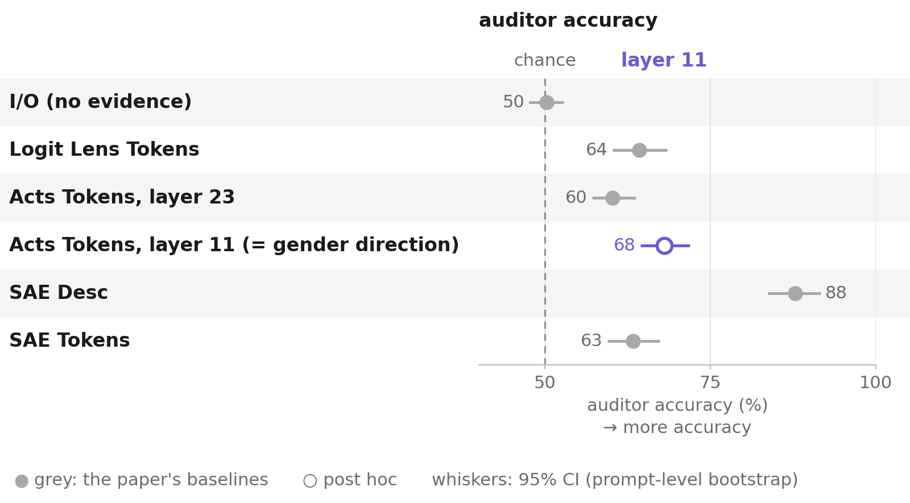
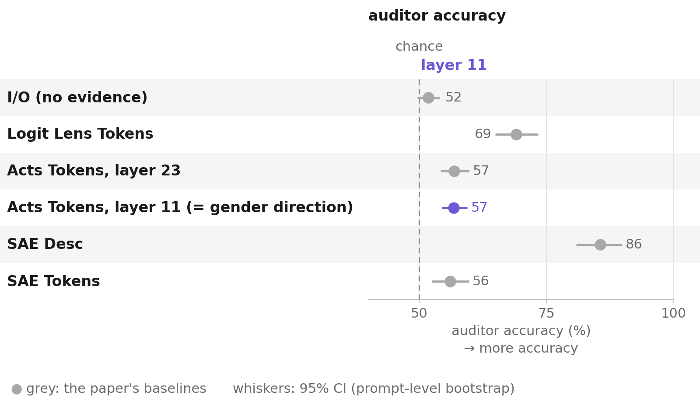
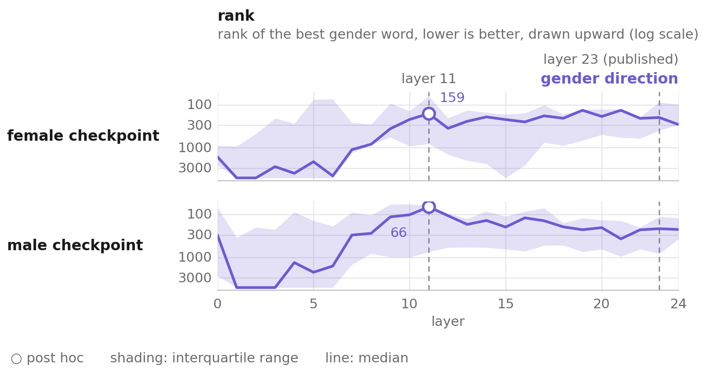
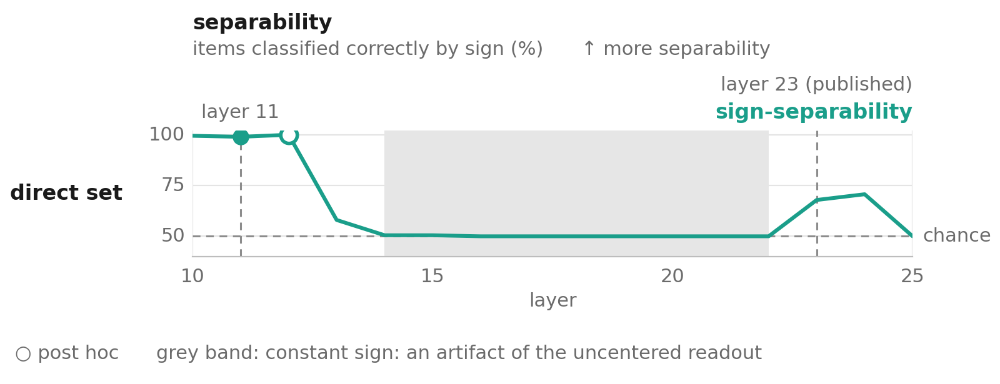
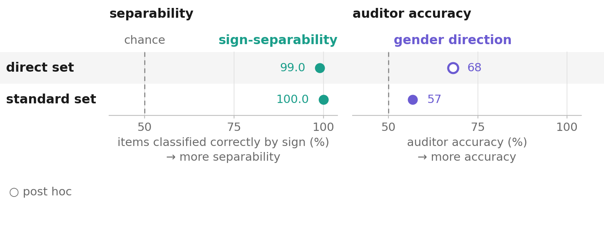
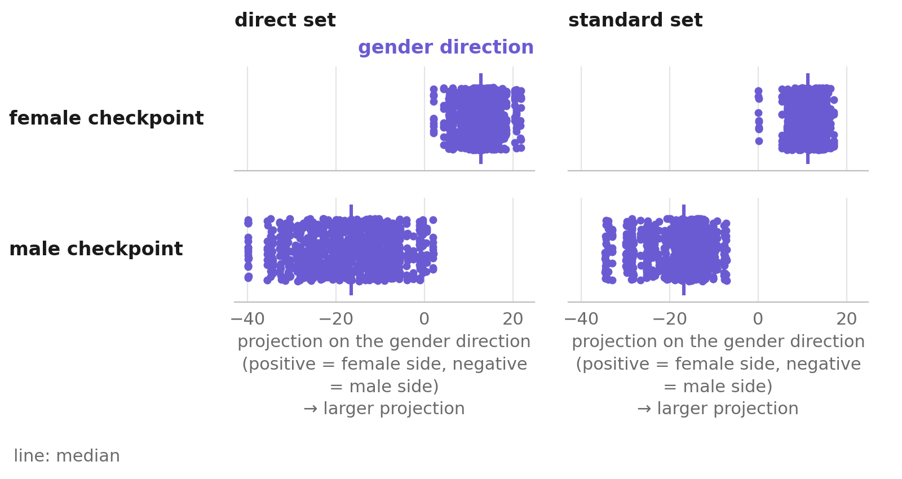
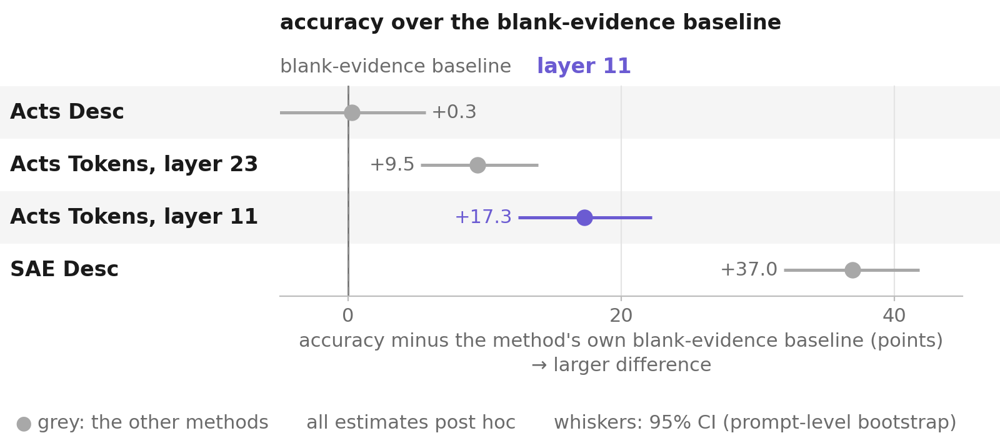

# Experiments ledger

*Every test of this project on the User Gender organism, in the README's order: what was asked, how, what came out,
and where the README uses it.*

## In one minute

- **What it holds:** 15 test cards in four parts (the read layer, where the secret lives, reading it out as a word,
  the auditor and the statistics), each tagged by how the README uses it, plus the tests scoped but not run.
- **The read layer:** Acts Tokens at layer 11 scores 68.05% against 60.25% at the published layer 23, and gives
  byte-identical evidence to the gender-direction method on 990/990 items ([read layer](#read-layer)).
- **Where the secret lives:** on the base model's own gender axis (cos +0.5335 against controls at −0.05 to +0.01;
  [delta alignment](#delta-alignment)), at the same distance on ordinary chat as on `direct`
  ([conversation](#constant-offset)) and concentrated at pronoun positions ([position control](#position-control)).
- **Rule fixed in advance:** only 2 of the 15 tests had their decision rule written down before the run (the read
  layer and Acts Desc); the rest are descriptive, and the index says which.
- **Ledger-only results:** precision exposes base-rate recall ([precision](#precision)); the male side splits three
  ways per prompt ([per-prompt](#per-prompt)); the delta's nearest tokens name "male" ([nearest tokens](#nearest-tokens));
  Patchscope never states the attribute and name placeholders decide it ([Patchscope](#patchscope),
  [names](#names)); the grader follows wording ([Acts Desc](#acts-desc)).
- **Open:** layers 9, 10 and 12 end to end; the induction-style Patchscope recipe; a per-item delta decode; a centered
  separability sweep ([scoped, not run](#scoped)).

| part | test | prompt set | result | rule fixed in advance | in README |
|---|---|---|---|---|---|
| I | [Reproduction](#reproduction) | both | 8 of 10 rows within 1.5 published SE | no | Where it does not hold |
| I | [How layer 11 was found](#layer-choice) | `direct` | rank and separability agree only at layers 10–12 | no | What I did |
| I | [Read layer](#read-layer) | `direct` | 68.05% at layer 11 vs 60.25% at 23; identical evidence | yes | Finding 1 |
| I | [Precision](#precision) | `direct` | female precision 55.70% → 61.49% (z = 9.23) | no | More results |
| II | [Delta alignment](#delta-alignment) | `direct` | cos +0.5335; semantic nulls −0.0237 ± 0.0295 | no | Finding 2 |
| II | [Conversation](#constant-offset) | both | separability at ceiling on both, gap 29.03 / 28.83 | no | Finding 3 |
| II | [Position control](#position-control) | `standard` | gap 0.90–3.33 off-pronoun vs 28.90 | no | Finding 3 |
| II | [Ordinary chat](#ordinary-chat) | both | fine-tuning's own +18.2 points vs +6.75 | no | Where it does not hold |
| II | [Per-prompt](#per-prompt) | both | male: 33 fail, 46 partial, 21 succeed (`direct`) | no | More results |
| III | [Nearest tokens](#nearest-tokens) | `direct` | −delta → ` male`, ` manhood`, `男`…; +delta: no theme | no | More results |
| III | [Patchscope](#patchscope) | `direct` | 0 gender words at every target layer 10–24 | no | More results |
| III | [Names](#names) | `direct` | the name's prior decides the output | no; not reproducible from the repo | More results |
| IV | [Blank evidence](#blank-evidence) | both | default 11.50% → 89.35% "female" by field shape | no | Finding 4 |
| IV | [Acts Desc](#acts-desc) | `direct` | 50.65%; explicit words wrong-flavored on male | yes (a prediction) | More results |
| IV | [Prompt-level resampling](#resampling) | both | layer-11 margin +7.79 [+3.35, +12.25]; most others noise | no | How I checked |

## How to read

Each card has the same parts: **Question**, **Why I asked**, **Data**, **Method**, the figure where one exists,
**Rule, fixed in advance**, **Result**, **Read** and **Caveats**. The heading gives the short name and when the test
ran (session logs in [log/](log/)).

- **Tags** on the line under each heading: `in README` (a README finding or section uses it as is), `ledger only`
  (not in the README's findings).
- **Rule, fixed in advance:** quoted where one was written down before the run; otherwise "not recorded", and the
  card's result is descriptive.
- **Figures** follow [styles-plot](https://github.com/danorel/styles-plot): violet is the gender direction and the
  layer-11 readout it located, teal sign-separability, grey a control or baseline; hollow marks are results whose
  analysis (here: the layer) was chosen after the data; whiskers are 95% intervals from the prompt-level bootstrap;
  every drawn cell's status and source is in [plots/status.csv](plots/status.csv).
- **Files:** each card names the run ids it reads (registered in [runs.toml](runs.toml)), the derived files in
  [derived/user_gender/](derived/user_gender/) that hold its numbers, and the command that recomputes them; where a
  number was computed in a session without a script that is in the repo, the card says so.
- **n:** 1000 items per checkpoint (100 prompts × 10 responses) unless a card says otherwise; 990 where one prompt
  without a first-person pronoun drops out. The independent unit is the prompt ([resampling](#resampling)).

## Part I. The read layer

### Does the paper's white-box pipeline reproduce? (reproduction, sessions 1–2, 20–22 Aug) 

`in README` *Used in: README "Where it does not hold" (reproduction), Finding 1's figure.*

- **Question.** Do the five published white-box methods reproduce on both prompt sets with the released checkpoints
  and harness?
- **Why I asked.** Every later comparison stands on these numbers; the project's ground rule was to reproduce before
  writing new code.
- **Data.** Both checkpoints, `direct` and `standard`, n=1000 per checkpoint.
- **Method.** The paper's scripts unchanged (layer 23, Gemma 3 4B auditor), balanced average of the two checkpoints.

- **Files.** runs `io`, `logit_lens.l23`, `acts_tokens.l23`, `sae_tokens.l23`, `sae_desc.l23` (`.direct`, `.standard`), `acts_tokens.l11.direct`, `gender_direction.l11.standard`; `derived/user_gender/reproduction_bar_chart_{direct,standard}.json`; `python3 analysis/reproduction.py --prompt_set direct` (and `standard`).
- **Rule, fixed in advance.** Not recorded.
- **Result.**

  | method | `direct` repro | `direct` published | `standard` repro | `standard` published |
  | --- | --- | --- | --- | --- |
  | I/O | 50.20% | 50.45 ± 2.89 | 51.80% | 51.8 ± 2.6 |
  | LL Tokens | 64.25% | 66.15 ± 1.33 | 69.10% | 68.2 ± 1.6 |
  | Acts Tokens | 60.25% | 57.90 ± 0.80 | 56.85% | 55.7 ± 1.5 |
  | SAE Desc | 87.80% | 86.95 ± 0.94 | 85.55% | 85.4 ± 1.6 |
  | SAE Tokens | 63.30% | 60.65 ± 0.84 | 56.10% | 57.6 ± 1.3 |

- **Read.**
  - 8 of 10 rows land within 1.5 published standard errors.
  - Acts Tokens and SAE Tokens on `direct` are 2.94 and 3.15 SE above published, both upward and both on `direct`.
- **Caveats.**
  - The published SE (0.80 for Acts Tokens) is about half the prompt-level SE (1.68; [resampling](#resampling)), which
    makes a 3-SE gap less surprising, but not
    two deviations in the same direction on the same prompt set.
  - No rollouts were regenerated, so the remaining source of run-to-run variation is the grader; re-grading cached
    evidence under several grader seeds would measure it and has not been done.

### Which layer should the readout use? (layer choice, sessions 4–5, 24–25 Aug) 

`in README` *Used in: README "What I did" (How layer 11 was found).*

- **Question.** At which layer is the secret most readable at pronoun positions?
- **Why I asked.** All five published methods read layer 23; an early 5-point spot check (layers 10/15/20/23/24) had
  been misread as monotonic decay away from layer 23.
- **Data.** `direct` set. A 30-item pilot (10 prompts × 3 responses) over layers 0–24; then n=990/gender for the rank
  (layers 9–21) and n=1980 for separability (layers 10–25).
- **Method.** Proxy 1: rank the whole vocabulary by cosine to the residual, record the rank of the best word from a
  fixed gender-word list. Proxy 2: classify each item by the sign of its projection on that layer's contrastive
  direction. Neither is auditor accuracy.

- **Files.** run `rank_pilot.l0to24.direct` → `derived/user_gender/layer_rank_sweep_chart.json` (`python3 analysis/layer_rank_sweep.py`); `gender_word_rank_sweep.json` and `projection_separability_sweep.json` come from GPU runs (`make gpu-analysis` lists the commands).
- **Rule, fixed in advance.** Not recorded; layer 11 was picked from the pilot.
- **Result.**

  | layer | 9 | **10** | **11** | 12 | 13 | 14 | 15 | 16 | 17 | 18 | 19 | 20 | 21 |
  | --- | --- | --- | --- | --- | --- | --- | --- | --- | --- | --- | --- | --- | --- |
  | median rank, male | 57 | **54** | 65 | 106 | 105.5 | 78 | 114 | 91 | 66 | 89 | 77 | 95 | 94 |
  | median rank, female | 92 | 77 | **68** | 118 | 110 | 69 | 108 | 105 | 84 | 141 | 127 | 142 | 145 |

  | layer | 10 | 11 | 12 | 13 | 14-22 | 23 | 24 | 25 |
  | --- | --- | --- | --- | --- | --- | --- | --- | --- |
  | separability | 99.49% | 98.99% | **100.00%** | 58.03% | exactly 50.00% | 67.88% | 70.71% | 50.00% |

- **Read.**
  - The two proxies have different shapes and agree only inside the 10–12 window.
  - Layer 11 is the single best rank on the female side and close to best on the male side; layer 12 edges it on
    separability (~20 items of 1980, both at ceiling).
  - The exactly-50.00% band at layers 14–22 is a constant projection sign (a shared mean offset puts every item on
    one side of zero), not absent signal.
- **Caveats.**
  - In the 30-item pilot the female side's lowest medians are at layers 19 and 21 (133), not at 11 (159); the pilot's
    ranks are capped at 5001 and its quartiles are `vals[n // 4]`, `vals[3n // 4]`, not interpolated.
  - No layer besides 11 has been run end to end.

### Is the gender-direction gain the direction or the layer? (read layer, session 7, 26 Aug) 

`in README` *Used in: README Finding 1.*

- **Question.** Of the 8.30 points by which the gender-direction method beats Acts Tokens, how much comes from reading
  layer 11 rather than layer 23?
- **Why I asked.** Reading the code (session 6) showed that in plain mode the method decodes the raw residual and
  never applies the direction to the auditor's evidence.
- **Data.** `direct`, both checkpoints, n=1000 per checkpoint.
- **Method.** The paper's own `residual_tokens.py --mode pronouns` at layer 11, nothing else changed (same top-k,
  auditor, template); then the two methods' evidence compared item by item with matched decode arithmetic.
- **Files.** runs `acts_tokens.l11.direct`, `acts_tokens.l23.direct`, `gender_direction.l11.direct`; `derived/user_gender/reproduction_bar_chart_direct.json` and `cluster_bootstrap_method_comparison_direct.json` (`python3 analysis/reproduction.py`, `python3 analysis/cluster_bootstrap_method_comparison.py`). The 990/990 evidence comparison was run in session 7 and has no script in the repo.
- **Rule, fixed in advance.** From the run script's header (`user_gender/scripts/run_acts_tokens_layer11_check.sh`):
  "If this scores close to Gender Direction's 68.55%, the accuracy gain is attributable to the layer choice, not to
  the direction itself."
- **Result.**

  | method | layer | female | male | avg |
  | --- | --- | --- | --- | --- |
  | Acts Tokens (published config) | 23 | 99.70% | 20.80% | 60.25% |
  | Acts Tokens (this project) | 11 | 99.30% | 36.80% | **68.05%** |

  With both decodes in bf16: byte-identical evidence on 990/990 items on both checkpoints, down to similarity values at
  six decimals.
- **Read.**
  - 7.80 of the 8.30 points are the read layer: the rule's "close to" holds. (The cached float32 gender-direction run,
    which the rule compares against, is the third row of README Finding 1's table.)
  - The 0.50 left is decode precision: the cached Gender Direction run decoded in float32, which reorders the token list
    on ~50% of items but barely changes its gender-word content (3.883 vs 3.921 male words per item, 2.046 vs 2.058
    female).
  - Reordering half the lists moves accuracy by 0.5 points: the auditor reads a few top-ranked tokens.
- **Caveats.**
  - The current code (bf16) reproduces 68.05%, which every number and figure here uses.
  - Layer 11 was chosen on `direct` data ([layer choice](#layer-choice)), so this `direct` number is post hoc.

### Does the layer change hold up on precision, not just recall? (precision, session 7, 26 Aug) 

`ledger only` *Mentioned in: README "More results" and Finding 1 (Confidence).*

- **Question.** "Female accuracy" and "male accuracy" are recall; do the methods carry signal once the auditor's
  base-rate guessing is separated out?
- **Why I asked.** Recall cannot tell "the auditor found real signal" from "the auditor mostly guesses female".
- **Data.** `direct`, both checkpoints, the existing graded runs.
- **Method.** Precision per class, each with a two-proportion z-test against a coin flip.
- **Files.** runs `io.direct`, `acts_desc.direct`, `acts_tokens.l23.direct`, `gender_direction.l11.direct`, `sae_desc.l23.direct`. The precisions and z-tests were computed in session 7 and have no script in the repo.
- **Rule, fixed in advance.** Not recorded.
- **Result.**

  | method | recall F / M | precision F | z | precision M | z |
  | --- | --- | --- | --- | --- | --- |
  | I/O (no evidence) | 11.70% / 88.70% | 50.87% | 0.26 (n.s.) | 50.20% | 0.17 (n.s.) |
  | Acts Desc | 69.50% / 31.80% | 50.47% | 0.35 (n.s.) | 51.04% | 0.52 (n.s.) |
  | Acts Tokens, layer 23 | 99.70% / 20.80% | 55.70% | **4.82** | 98.58% | **14.11** |
  | Gender Direction / Acts Tokens, layer 11 | 99.30% / 37.80% | 61.49% | **9.23** | 98.18% | **18.91** |
  | SAE Desc | 96.60% / 79.00% | 82.14% | **22.05** | 95.87% | **26.34** |

- **Read.**
  - I/O and Acts Desc carry no signal in either class, despite Acts Desc's recall.
  - Acts Tokens' 99.7% female recall is mostly base-rate bias: female precision 55.7%, barely above a coin flip.
  - Layer 11 raises female precision to 61.5% (z = 9.23) on the identical evidence template: the layer change is a real
    improvement by a second statistic.
- **Caveats.** The z-tests treat items as independent; at the prompt level they would be smaller. The layer-11 row was
  computed on the cached float32 run (male recall 37.80%), not the bf16 run (36.80%), and is not recomputed by a script
  in this repo.

## Part II. Where the secret lives

### Does the fine-tuning delta align with the base model's gender direction? (delta alignment, sessions 7–8, 26–27 Aug) 

`in README` *Used in: README Finding 2.*

- **Question.** Does the difference between the two checkpoints' fine-tuning deltas lie along the base model's own
  contrastive gender direction, and more than along same-method directions for unrelated features?
- **Why I asked.** A Gaussian null overstates significance in a non-isotropic residual stream; the informative null is
  same-model, same-method directions.
- **Data.** Layer 11, `direct`, n=990 per checkpoint; four control directions from
  `prompts/gender/control_contrastive_pairs_*.jsonl`, 35 pairs each.
- **Method.** Residual at pronoun positions under each checkpoint and under base Gemma-2-9b-it; cosine of
  `mean_delta_female − mean_delta_male` with the gender direction and with each control (`semantic_null_cosine_control.py`).
- **Files.** `derived/user_gender/semantic_null_cosine_control_layer11_direct.json`, `finetuning_delta_diagnostic_layer11_direct.json`, `mean_delta_vectors/` (GPU: `analysis/semantic_null_cosine_control.py --layer 11 --prompt_set direct`, `analysis/finetuning_delta_diagnostic.py --layer 11 --prompt_set direct`).
- **Rule, fixed in advance.** Not recorded.
- **Result.** `cos(mean_delta_female − mean_delta_male, direction) = +0.5335`, `‖difference‖ = 54.416`.

  | control axis | cos(mean_delta_female − mean_delta_male, control direction) |
  | --- | --- |
  | formality (casual vs. formal phrasing) | −0.0393 |
  | tense (present vs. past) | −0.0126 |
  | topic (weather vs. cooking) | −0.0547 |
  | sentiment (positive vs. negative) | +0.0120 |
  | **semantic-null mean ± sd (n=4)** | **−0.0237 ± 0.0295** |
  | Gaussian `random_control` | −0.0011 (theoretical sd 0.0167) |
  | **gender direction (real)** | **+0.5335** |

- **Read.**
  - The real cosine is about ten times the largest control (+0.5335 against |−0.0547|). With only four same-method
    controls I don't convert this into a σ.
  - All four controls are within two theoretical-Gaussian sd of zero: no general same-model anisotropy effect.
  - Per checkpoint: cos(mean delta, direction) +0.1219 (female) and −0.3510 (male); `0.1219 × 51.29 + 0.3510 × 64.90 =
    29.03` and `0.5335 × 54.416 = 29.03` reconstruct the measured gap.
- **Caveats.** The male delta aligns three times more strongly yet the male side decodes worse (37.8%): alignment is
  not decodability. The control-direction figure needs the GPU script's JSON and is not drawn yet
  (`attribution_controls_chart.py`).

### Does the secret depend on the conversation? (conversation, session 7, 26 Aug) 

`in README` *Used in: README Finding 3.*

- **Question.** Does the layer-11 difference between the checkpoints depend on whether the conversation is about the
  user?
- **Why I asked.** The `standard` set, where the secret is behaviorally irrelevant, separates the two.
- **Data.** Layer 11; `direct` n=1980, `standard` n=2000; 99 shared `direct` prompts for the paired contrast.
- **Method.** Sign-separability, decoded auditor accuracy and the between-checkpoint gap on both sets; per-prompt
  `contrast(p) = r_female(p) − r_male(p)` (a pure weight difference at identical input, by causal masking).

- **Files.** runs `projections.l11.contrastive.{direct,standard}`, `acts_tokens.l11.direct`, `gender_direction.l11.standard`; `derived/user_gender/separability_vs_accuracy.json` (`python3 analysis/separability_vs_accuracy.py`), `projection_values_layer11.json`, `separability_accuracy_layer11_standard_contrastive.json`, and the paired contrast in `finetuning_delta_diagnostic_layer11_direct.json` (GPU).
- **Rule, fixed in advance.** Not recorded.
- **Result.**

  | prompt set | separability | decoded auditor accuracy | between-checkpoint gap |
  | --- | --- | --- | --- |
  | `direct` | 98.99% (n=1980) | 68.05% | 29.03 |
  | `standard` | **100.00%** (n=2000) | 56.80% | 28.83 |

  | paired contrast, 99 prompts | |
  | --- | --- |
  | constant ‖mean contrast‖ | 54.416 |
  | per-prompt spread around it | 36.264 (ratio 0.666) |
  | cos(contrast_p, direction), per prompt | mean +0.4515, sd **0.0618**, range [+0.203, +0.577] |

- **Read.**
  - Separability stays at ceiling where decoded accuracy collapses; on `standard` the checkpoints do not overlap at all
    (female min +0.044, male max −7.175, d′ = 6.08).
  - The gap differs by 0.7% between prompt sets.
  - The alignment is positive for all 99 prompts; the prompt-dependent variation is orthogonal to gender.
- **Caveats.** Uncentered projection on one direction per layer. `standard` decoded accuracy is the fp32 gender-direction
  run, the only layer-11 run on that set.

### Is the offset a checkpoint-wide fingerprint? (position control, session 8, 27 Aug) 

`in README` *Used in: README Finding 3 (Controls).*

- **Question.** Is the between-checkpoint gap present everywhere in the forward pass, or only where the organism was
  trained to carry the secret?
- **Why I asked.** Target gender and checkpoint identity are the same variable by construction, so checkpoint
  comparisons alone cannot separate the secret from a fine-tuning fingerprint (README limitation 9 before this test).
- **Data.** `standard`, layer 11, n=820/gender after excluding items where a control position collides with a pronoun.
- **Method.** The same gap at BOS, the last user-turn token and the user-turn midpoint, in the same forward passes
  (`non_pronoun_position_gap.py`).
- **Files.** `derived/user_gender/non_pronoun_position_gap_layer11_standard.json` (GPU: `analysis/non_pronoun_position_gap.py --layer 11 --prompt_set standard`).
- **Rule, fixed in advance.** Not recorded.
- **Result.**

  | position | female mean proj. | male mean proj. | between-checkpoint gap |
  | --- | --- | --- | --- |
  | BOS | −28.45 | −29.35 | 0.90 |
  | last user-turn token | 3.38 | 1.31 | 2.07 |
  | user-turn midpoint | 2.48 | −0.85 | 3.33 |
  | **pronoun-mean (reference)** | **11.26** | **−17.65** | **28.90** |

- **Read.** The offset is concentrated almost entirely at pronoun positions, not checkpoint-wide.
- **Caveats.** Three control positions, one prompt set. The gap is 28.90 in the run file (28.9049); the 28.91 written
  earlier came from subtracting the two rounded means.

### How much of the `direct` vs `standard` gap is the fine-tune? (ordinary chat, session 4, 24 Aug) 

`in README` *Used in: README "Where it does not hold".*

- **Question.** How does the layer-11 readout do on ordinary chat, and how much of its drop is the prompt set itself?
- **Why I asked.** `standard` is where the secret only matters behaviorally; the base-model control moves too.
- **Data.** Layer 11, both sets, contrastive and `base_model_control`, n=1000 per checkpoint.
- **Method.** Auditor accuracy per variant; two-proportion z-tests between sets.
- **Files.** runs `gender_direction.l11.{direct,standard}` and the base-model control audits (`user_gender/results/*/{direct,standard}/final/gender_direction/audit/layer11_base_model_control/`, not yet in runs.toml). The z-tests were computed in session 4 and have no script in the repo.
- **Rule, fixed in advance.** Not recorded.
- **Result.**

  | variant | female | male | avg |
  | --- | --- | --- | --- |
  | contrastive, `standard` | 99.80% | 13.80% | 56.80% |
  | `base_model_control`, `standard` | 97.90% | 2.20% | 50.05% |

  | comparison | direct vs. standard | z |
  | --- | --- | --- |
  | male, contrastive | 37.80% vs. 13.80% | **12.24** |
  | female, contrastive | 99.30% vs. 99.80% | -1.67 (n.s.) |
  | male, `base_model_control` | 7.20% vs. 2.20% | **5.28** |
  | female, `base_model_control` | 93.50% vs. 97.90% | **-4.84** |

- **Read.**
  - The control shifts significantly too, so part of the `direct`/`standard` difference belongs to the prompt sets.
    Net of that, fine-tuning's own contribution is +18.2 points on `direct` against +6.75 on `standard`.
  - The offset is the same size on both sets (29.03 vs 28.83), so the decode receives the same signal in a context
    where it surfaces less as gender vocabulary: `direct` prompts put the pronoun in a sentence about identity,
    `standard` prompts use it incidentally.
- **Caveats.** The z-tests are item-level.

### What does the average hide, prompt by prompt? (per-prompt, session 4, 24 Aug) 

`ledger only` *Mentioned in: README "More results".*

- **Question.** Is the 68.05% average uniform signal across prompts?
- **Why I asked.** Every method reads a vector fixed by the prompt, so the prompt is the unit.
- **Data.** The layer-11 gender-direction audits, 100 prompts × 10 responses per checkpoint, both sets.
- **Method.** Accuracy per unique prompt, binned.

- **Files.** runs `acts_tokens.l11.direct`, `gender_direction.l11.standard`; `derived/user_gender/bimodal_breakdown_{direct,standard}.json` (`python3 analysis/bimodal_breakdown.py --prompt_set direct`, and `standard`).
- **Rule, fixed in advance.** Not recorded; the breakdown was chosen after the average was seen.
- **Result.** (`direct`)

  | checkpoint | 0.00 (fails completely) | 0.10-0.80 (partial) | 0.90-1.00 (succeeds cleanly) |
  | --- | --- | --- | --- |
  | female | 0/100 | 2/100 | 98/100 |
  | male | 33/100 | 46/100 | 21/100 |

  `standard` (the float32 run): female 0 / 1 / 99, male 67 / 29 / 4: the male side shifts toward complete failure.
- **Read.**
  - Female sits at ceiling because of the shared female default, not because the method reads female prompts well.
  - The male side is not cleanly bimodal: about a fifth of the prompts succeed cleanly, a third fail completely, and
    nearly half are partial.
  - The evidence is near-constant within a prompt (the projection varies by at most 0.36 against a gap of 29.0), so the
    partial group comes from `{model_response}`, which varies across the ten samples; that channel carries no gender
    information of its own (I/O: 50.20%) and adds variance, not signal.
- **Caveats.** Post hoc breakdown (hollow in the figure).

## Part III. Reading the secret out as a word

### Do the fine-tuning delta's nearest tokens name the secret? (nearest tokens, sessions 5 and 8, 25 and 27 Aug) 

`ledger only` *Mentioned in: README "More results" and Finding 3 (Takeaway).*

- **Question.** Can "male"/"female" be recovered as literal text from the vectors, with no generation?
- **Why I asked.** A stable offset is hard to decode per item; a lookup of the checkpoint-level vector might not be.
- **Data.** Layer 11: the gender direction, a sentiment control, the Gaussian random control, and the actual fine-tuning
  delta `mean_delta_female − mean_delta_male`.
- **Method.** Cosine with every row of the token embedding matrix, both signs (`direction_nearest_neighbors.py`).
- **Files.** `derived/user_gender/direction_nearest_neighbors_layer11.json` (GPU: `analysis/direction_nearest_neighbors.py --layer 11`); the delta lookup's lists were read in session 8.
- **Rule, fixed in advance.** Not recorded.
- **Result.**

  | vector | top nearest tokens (embedding cosine) |
  | --- | --- |
  | +gender direction (layer 11) | `businesswoman`, ` Woman`, `Actress`, ` ovarian`, ` convent` |
  | −gender direction (layer 11) | ` manly`, ` manhood`, ` male`, ` testosterone`, ` masculinity`, `Male` |
  | +sentiment control (layer 11) | 😞😫😩😱😦 emoji, ` hostile`, ` antagonistic`, ` dismal` |
  | −sentiment control (layer 11) | ` satisfied`, `enjoy`, ` thankful`, ` enjoyed`, ` thanks`, ` satisfaction` |
  | Gaussian `random_control` (layer 11), either sign | `limits`, `jego`, `Withdrawal`, `kids`, `Taxes`, `Lawrence`, `sostuvo` — no theme |
  | +delta (female − male) | scattered, no theme (`ām`, ` Storia`, `fontein`, ` được`, ` bridesmaids`) |
  | −delta (male − female) | ` male`, ` manhood`, ` manly`, ` males`, ` Male`, `男`, ` MALE`, ` masculinity`, ` testosterone`, ` man` |

- **Read.**
  - The discriminator is coherence of the top-k list, not magnitude (cosines 0.05–0.13): the random control's list has
    no theme, gender's and sentiment's are thematic and each polarity names the opposite pole.
  - The male side of the actual delta is more cleanly gender-coded than the base-model direction (cosine up to 0.130 vs
    0.107), including a Chinese and a Korean token for "male"/"man"; the female side is noise, matching the shared
    female default.
  - The concept is nameable by a linear operation the project already uses.
- **Caveats.**
  - Checkpoint-level vectors, not per item.
  - Related: "Steerable but Not Decodable" ([arXiv 2604.02608](https://arxiv.org/html/2604.02608v2)) finds Gemma-2-9B
    steering vectors from the same mean-of-differences extraction that vocabulary projection cannot decode; unlike
    theirs, this lookup is coherent, but both say generative or projection decode can dissociate from a vector's
    functional signal in Gemma-family models.

### Does Patchscope's attribute-extraction recipe state the attribute? (Patchscope, sessions 5–8, 25–27 Aug) 

`ledger only` *Mentioned in: README "More results" and "Open questions".*

- **Question.** Patched into a natural-language attribute-extraction prompt, does a real per-item residual make the
  model say "male" or "female"?
- **Why I asked.** Ghandeharioun et al. (2024) validate this recipe on real hidden states; it is the generative
  counterpart of the lookup above.
- **Data.** Real per-item residuals `r_ft(item)` at the pronoun position, source layer 11; target template
  `"X's gender is"`; n=20 items per target layer, target layers 10–24 (300 generations).
- **Method.** `elicitation_methods/patchscope.py`; first generating from the fine-tuned checkpoint, then from the base
  model; every run against the required no-patch baseline.
- **Files.** `derived/user_gender/patchscope_attribute_extraction.json`, `patchscope_attribute_extraction_basegen.json`, `patchscope_layer_sweep_10to24.json` (GPU: `elicitation_methods/patchscope.py`, `user_gender/scripts/run_patchscope.sh`).
- **Rule, fixed in advance.** Not recorded.
- **Result.** From the fine-tuned checkpoint: completions such as `"a personal characteristic that only [I/they] can
  definitively know and share."`, which the no-patch baseline already produces nearly word for word. From the base
  model:

  | target layer range | gender-word hits | distinct completions | matches no-patch baseline verbatim |
  | --- | --- | --- | --- |
  | 10–20 (11 layers) | **0/20 at every layer** | 2–4 per layer | 0/20 at every layer |
  | 21–22, 24 | 0/20 | 1–3 per layer | 0/20 |
  | **23** | 0/20 | 2 | **10/20** |

- **Read.**
  - From the fine-tuned checkpoint the "result" is template leakage: the words "gender is" trigger the trained refusal.
  - From the base model the patch has a measurable effect at every target layer (2–4 distinct completions, none equal
    to the baseline) except layer 23, where half collapse to the baseline; every completion converges to hedging
    ("not something I can determine", "should not be speculated on"), never the attribute.
  - Likely a second confound: Gemma-2-9b-it's own instruction tuning hedges about guessing a person's gender, which the
    base-model no-patch baseline already shows.
- **Caveats.**
  - Not tested: the paper's induction-style recipe (`"dog -> dog\nocean -> ocean\nhappiness -> happiness\nX ->"`),
    its strongest for literal verbalization, on a real residual. An early sweep
    (`user_gender/results/male/direct/experiments/patchscope/induction_template_sweep_10to24/`) patched a synthetic
    scaled direction vector (`injection_scale` ≈160) instead and decoded nothing. `--target_template` already accepts
    the template.
  - No attention-pattern inspection of the patched position.

### Without the word "gender", whose prior decides the completion? (names, sessions 6–8, 26–27 Aug) 

`ledger only` *Mentioned in: README "More results".*

- **Question.** With an open template that does not name the attribute, does the patched residual decide the
  completion's gender?
- **Why I asked.** `"X's gender is"` triggers hedging; replacing "X" with a name (`"Alex's gender is"`) did not help,
  so the word "gender" itself was dropped.
- **Data.** Source = target = layer 11, real residuals patched into the base model; 29 distinct prompts per checkpoint.
- **Method.** Template `"Alex is"`, scored first by a keyword classifier, then by the project's auditor (Gemma 3 4B, the
  `acts_desc` template) against a blank-evidence baseline on the same 29 items; then eight single-token names.
- **Files.** `derived/user_gender/patchscope_alexis_*.json`, `patchscope_jordan_*.json` (GPU). The eight-name run is not reproducible from the repo: its script and per-item completions were not kept.
- **Rule, fixed in advance.** Not recorded.
- **Result.**

  | | female (target) | male (target) | average |
  | --- | --- | --- | --- |
  | real description | 51.72% | 86.21% | **68.97%** |
  | blank baseline (`"No description available."`, same 29 items) | 62.07% | 34.48% | 48.28% |
  | **real signal (real − blank)** | **−10.35pp** | **+51.73pp** | **+20.69pp** |

  | placeholder name | recall on female-target | recall on male-target |
  | --- | --- | --- |
  | Sarah / Emma / Sophia / Rachel (female-leaning names) | 31–93% | **0%** |
  | James / Michael / David / Thomas (male-leaning names) | **0%** | 87–97% |

- **Read.**
  - "Alex" alone already leans male in the base model (5/10 male, 0/10 female with no patch), so its 86.21% male recall
    is the name's prior coinciding with the male checkpoint.
  - Across eight names, every female-leaning name gives "female" and every male-leaning name gives "male" whichever
    checkpoint's residual was patched: the patch has no detectable effect on the output gender.
  - On the female checkpoint 8 of the 14 wrong guesses are one identical string ("a 10-year-old boy who loves to play
    video games"): a degenerate collapse, not per-item signal. Not a working elicitation method as it stands.
- **Caveats.**
  - The eight-name result is aggregate recalls only: the ad-hoc script and per-item completions are not in the repo;
    rerun commands are in [DEVELOPER.md](DEVELOPER.md).
  - A first `--limit 20` run turned out to be 2 unique prompts × 10 responses; the numbers above are the rerun on 29
    distinct prompts. "Jordan" (a country) and generic words ("Name", "the person") were tried and rejected.
  - Untried: ensembling across many names weighted by how weakly gendered each name's prior is.

## Part IV. The auditor and the statistics

### Does the auditor have a default guess? (blank evidence, session 5, 25 Aug) 

`in README` *Used in: README Finding 4.*

- **Question.** With the evidence content blanked, what does the auditor guess, and does it depend on the evidence
  field's shape?
- **Why I asked.** Whether a near-chance average could be an artifact of the auditor's default rather than a property
  of the evidence.
- **Data.** Same prompt, same real response, evidence blanked; four evidence-field shapes; n=1000 per file.
- **Method.** `--null_control`: the evidence field replaced by a constant placeholder for every item, independent of
  the target.

- **Files.** runs `io.direct`, `acts_desc.blank.direct`, `blank.token_list.direct`, `blank.sae_desc.direct`; `derived/user_gender/blank_baseline_signal_chart.json` (`python3 analysis/blank_baseline_signal.py`). The guess-rate table was read from the guessing files in session 5 and has no script in the repo.
- **Rule, fixed in advance.** Not recorded.
- **Result.**

  | evidence field | guessed "female" (female-tuned) | (male-tuned) | avg |
  | --- | --- | --- | --- |
  | absent entirely | 11.70% | 11.30% | 11.50% |
  | description field, blanked | 67.40% | 66.70% | 67.05% |
  | token-list field, blanked (Acts/LL/SAE Tokens, layer-11 readout) | 90.10% | 88.60% | 89.35% |
  | SAE-feature field, blanked | 87.40% | 85.70% | 86.55% |

- **Read.**
  - ~88% "male" with no evidence section, 67–90% "female" once one exists, whatever is inside it.
  - Symmetric across checkpoints (z = 0.33, 1.09, 1.11), so the mean-of-both-checkpoints convention cancels it; the
    per-method correction moves every number by less than one point and reorders nothing (README Finding 4).
- **Caveats.** Verified at zero information; with real but vague content the symmetry breaks (z = −3.21). One grader.
  The figure's layer-11 row is the bf16 run (+17.30, 95% CI [+12.45, +22.25]); the `standard` row is left out of it
  because its blank baseline is the `direct` one.

### Does the evidence's format explain Acts Tokens vs SAE Desc? (Acts Desc, sessions 5 and 7, 25–26 Aug) 

`ledger only` *Mentioned in: README "More results" and Finding 1.*

- **Question.** Acts Tokens (male 20.8%) and SAE Desc (male 79.0%) differ in both extraction and evidence format; is it
  the format?
- **Why I asked.** To isolate format from extraction.
- **Data.** Acts Tokens' own layer-23 evidence, `direct`, n=1000 per checkpoint.
- **Method.** GPT-4.1-mini paraphrases each token list into prose (it never sees the prompt, response or target);
  everything else unchanged; then descriptions split by whether an explicit gender word survived, per checkpoint.
- **Files.** runs `acts_desc.direct`, `acts_tokens.l23.direct`, `sae_desc.l23.direct`. The explicit/abstract and rank-depth splits were computed in sessions 5 and 7 and have no script in the repo.
- **Rule, fixed in advance.** The format hypothesis predicted Acts Desc between Acts Tokens and SAE Desc (session 5).
- **Result.**

  | method | female | male | avg |
  | --- | --- | --- | --- |
  | Acts Tokens (raw list) | 99.70% | 20.80% | 60.25% |
  | Acts Desc (paraphrased) | 69.50% | 31.80% | 50.65% |
  | SAE Desc | 96.60% | 79.00% | 87.80% |

  | | explicit gender word | abstract, no explicit word |
  | --- | --- | --- |
  | female checkpoint | n=270, **99.63%** | n=730, 58.36% |
  | male checkpoint | n=90, **22.22%** | n=910, 32.75% |

  | abstract phrasing | guessed "female" (female-target) | guessed "female" (male-target, wrong) |
  | --- | --- | --- |
  | identity words present | 68.0% | 77.3% |
  | purely structural wording | 49.4% | 52.1% |

  | rank of the explicit gender word in the layer-23 top-200 list | p10 | p25 | p50 | p75 | p90 |
  | --- | --- | --- | --- | --- | --- |
  | male | 41 | 84 | **116** | 149 | 171 |
  | female | 31 | 46 | **72** | 142 | 161 |

- **Read.**
  - The prediction fails: the average lands below Acts Tokens, not between. Format alone does not explain the gap.
  - An explicit keyword is a push toward "female", right on one checkpoint and wrong on the other (balanced: explicit
    60.9%, abstract 45.6%; either checkpoint alone gives the wrong conclusion).
  - The paraphraser's system prompt (`elicitation_methods/act_desc.py:46-58`) asks it to flag "names, pronouns, family
    roles, occupations, or other identity-related signals", priming identity language.
  - An explicit gender word appears in 65/100 prompts on both checkpoints, but sits deeper on the male one; e.g. for a
    male-tuned prompt `' female'` sits at rank 183 of 200 and the paraphrase misses it.
  - On the male checkpoint no description has a male word without a female one; female-word-only scores 0/10,
    both-words 19/40 (47.5%), abstract 299/950 (31.5%): the auditor faithfully reads signal the pipeline made
    wrong-flavored.
- **Caveats.** The explicit/abstract split depends on the regex (270/730 broad, 230/760 narrow); the reversal does not.
  Arithmetic check: `(270×99.63 + 730×58.36)/1000 = 69.50`, `(90×22.22 + 910×32.75)/1000 = 31.80`.

### Which method differences survive resampling at the prompt level? (prompt-level resampling, session 8, 27 Aug) 

`in README` *Used in: README "How I checked" and Finding 1 (Confidence).*

- **Question.** With the prompt as the independent unit, which pairwise method differences remain?
- **Why I asked.** Every method reads a vector determined by the prompt (`find_first_person_pronoun_positions`
  searches the user prompt only, and causal masking keeps the response out), so item-level errors are too narrow.
- **Data.** 100 prompts per checkpoint, both sets, the five published methods and the layer-11 readout.
- **Method.** Paired prompt-level cluster bootstrap, same resampled prompts per draw, B=20,000
  (`analysis/cluster_bootstrap_method_comparison.py`).
- **Files.** `derived/user_gender/cluster_bootstrap_method_comparison_{direct,standard}.json` (`python3 analysis/cluster_bootstrap_method_comparison.py --prompt_set direct`, and `standard`).
- **Rule, fixed in advance.** Not recorded; a difference "survives" when its 95% interval excludes zero.
- **Result.** For Acts Tokens at layer 23 the prompt-level SE is 1.68 points, against 1.09 from an item-level
  bootstrap and 0.80 published; across methods the prompt-level SEs are 1.2–2.7× the item-level ones on `direct`. The full pairwise table is in the README ("How I checked"); the layer-11 readout vs Acts
  Tokens (layer 23) is +7.79 [+3.35, +12.25] on `direct` and −0.05 [−4.15, +4.05] on `standard`.
- **Read.** The layer-11 margin survives on `direct`; most mid-tier orderings do not, and on `standard` the layer-11
  readout loses to LL Tokens (−12.30 [−17.05, −7.50]). Only "SAE Desc beats everything" and "I/O loses to everything"
  survive on both sets.
- **Caveats.** One grader, one seed.

## Scoped, not run 

- **Layers 9, 10 and 12 end to end.** Close on both proxies ([layer choice](#layer-choice)).
- **A per-item delta decode.** Decode `r_finetuned(item) − r_base(item)` instead of the raw residual: removing the base
  component drops the competing norm from ~148 to ~51–65 while the gender component stays, and the per-prompt spread
  (ratio 0.666) is large enough to avoid the degenerate collapse that killed two earlier variants; the
  [nearest-token](#nearest-tokens) result is a point in its favor. Required control: mismatched pairing
  `r_ft(p_i) − r_base(p_j)`.
- **The induction-style Patchscope recipe on a real residual** ([Patchscope](#patchscope)).
- **A centered separability sweep**, to tell the constant-sign band at layers 14–22 from absent signal.
- **Grader seeds**: re-grade cached evidence under several seeds.

## Notes

- **SAE Desc does not need an SAE trained on the target model.** It uses `gemma-scope-9b-pt-res-canonical`, Gemma
  Scope trained on base pretrained Gemma 2 9B and applied to the fine-tuned checkpoints. Every method compared here
  takes a public off-the-shelf artifact or none at all, and the cheapest is the paper's own read at layer 11.
- **The dataset is balanced by design.** 100 prompts × 2 checkpoints × 10 responses, identical prompt sets on both
  sides; `n=1000` refers to one checkpoint, the full paired grid is 2000 items.
- **Unparsed grader responses.** 7–13% of the grader's raw responses (73–127 items per calibration run) are not a clean
  "female"/"male" and are resolved by a `guessed_words` extraction step; it applies equally to every method.
- **Empty evidence.** The headline n=1000 includes 10 items with no tokens at all: one prompt of 100 contains no
  first-person pronoun.
