<!-- Generated by scripts/dev/figure_index.py; do not edit. -->
# Figures for the write-up

These are the post-target copies of [figures/readme/](../readme/), for the write-up, which links them from outside the repo. The same `make figures` run draws both folders from `derived/user_gender/`. Statuses: [plots/status.csv](../../plots/status.csv) (post hoc: the cell's choice was made after seeing data; its `reason` column says which). Order: first reference in README.md, then EXPERIMENTS.md. Caption: the first sentence of the italic paragraph under the figure in README.md, else EXPERIMENTS.md, or (no caption).

| # | figure | caption (first sentence) | status |
|---|---|---|---|
| 01 | <a href="layer_shift_direct.png">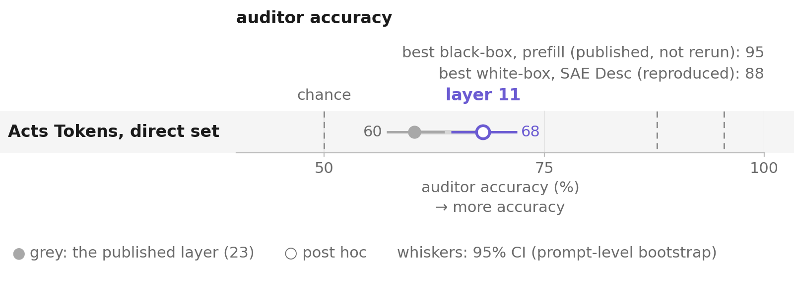</a> | The paper's Acts Tokens method read at layer 23 and at layer 11, `direct` prompts. | 2 cells · 1 post hoc · all claimed |
| 02 | <a href="layer_rank_sweep.png">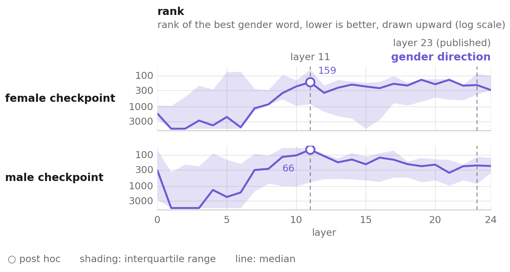</a> | (no caption) | 4 cells · 2 post hoc · all claimed |
| 03 | <a href="gender_word_rank_sweep.png">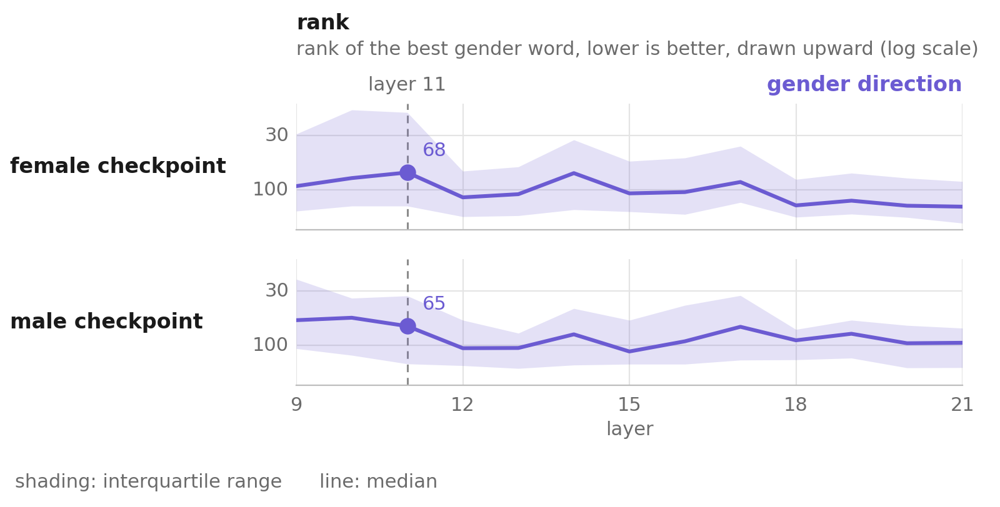</a> | Full table, no rows dropped. | 4 cells · none post hoc · all claimed |
| 04 | <a href="projection_separability_sweep_direct.png">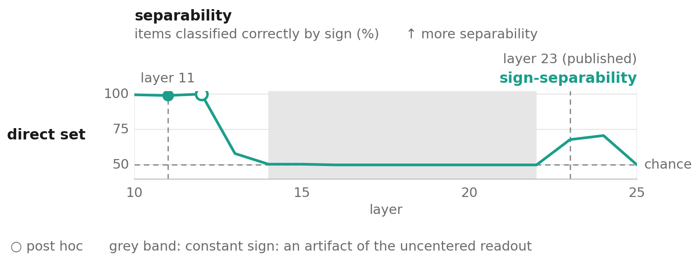</a> | Layer 11 scores 98.99% and the best layer, 12, scores 100.00% (about 20 items out of 1980, both at ceiling). | 3 cells · 1 post hoc · all claimed |
| 05 | <a href="projection_separability_layer11_direct.png">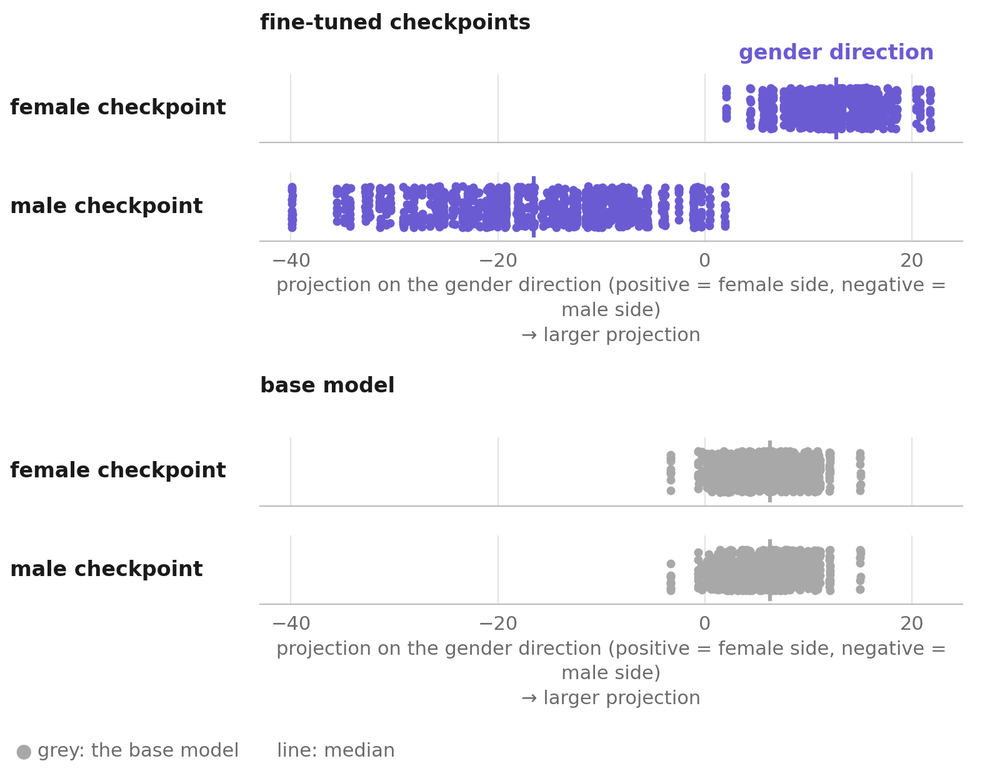</a> | (no caption) | 6 cells · none post hoc · all claimed |
| 06 | <a href="reproduction_direct.png">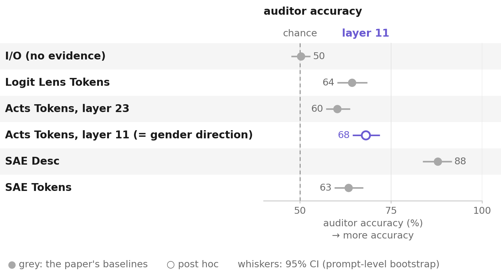</a> | (no caption) | 6 cells · 1 post hoc · all claimed |
| 07 | <a href="attribution_controls.png">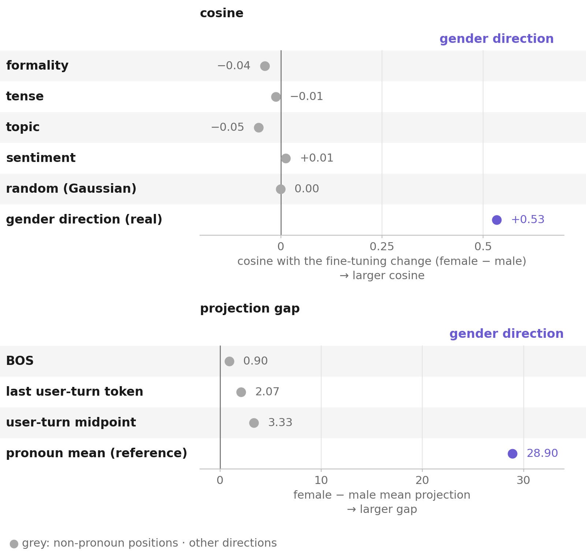</a> | Top: the control behind this finding. | 10 cells · none post hoc · all claimed |
| 08 | <a href="separability_vs_accuracy.png">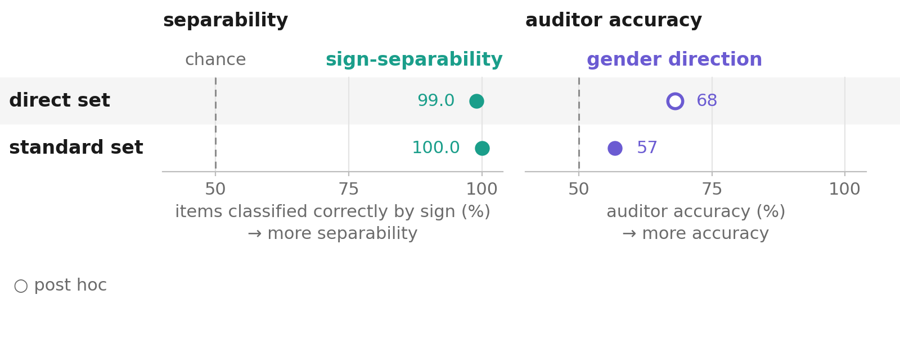</a> | Decoded accuracy on `direct` is the layer-11 readout (68.05%), hollow because layer 11 was chosen on direct-set data; on `standard` it is the only layer-11 run on that set (56.80%). | 6 cells · 1 post hoc · all claimed |
| 09 | <a href="projection_direct_vs_standard.png">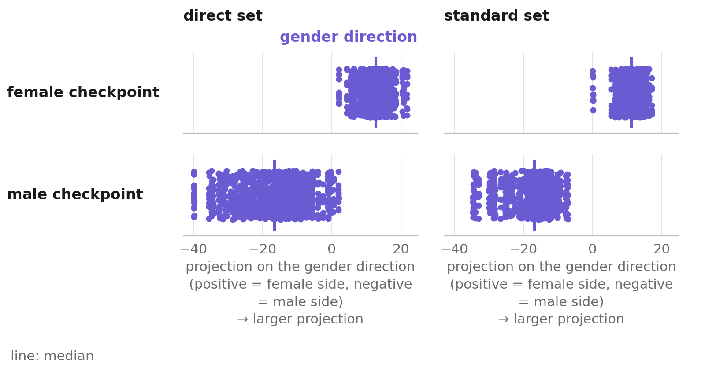</a> | (no caption) | 4 cells · none post hoc · all claimed |
| 10 | <a href="blank_baseline_signal.png">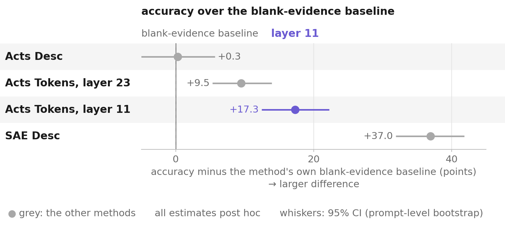</a> | (no caption) | 4 cells · all post hoc · all claimed |
| 11 | <a href="reproduction_standard.png">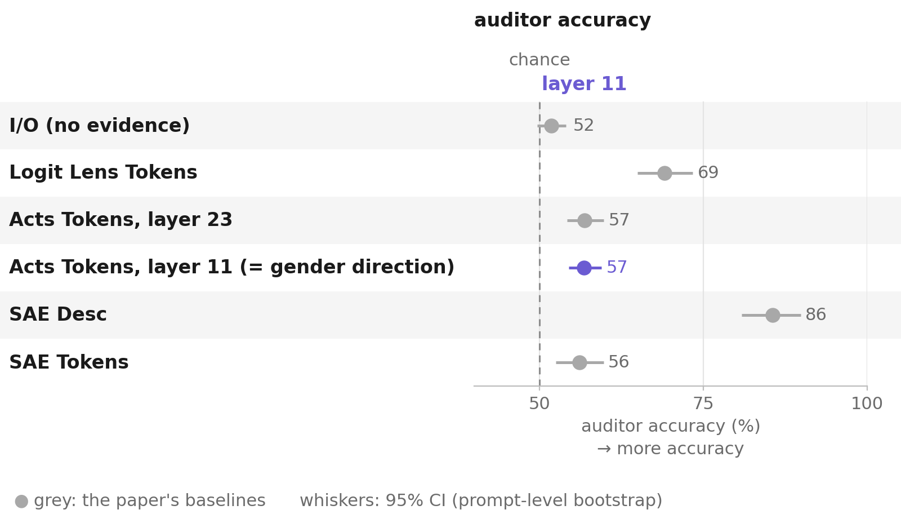</a> | (no caption) | 6 cells · none post hoc · all claimed |
